# PBKSI — Laboratorium 3

**Delegowanie autoryzacji do zasobów w OAuth2**

Artur Gubanovich, 08.11.2026
Środowisko: macOS (arm64), Docker 27.4 (Colima), Keycloak 26.4.2, Python 3.12 (Flask 3.1, PyJWT 2.10, cryptography 46), Chromium (Playwright) do zrzutów ekranu

Kilka słów na początek:

- **Usługa OAuth 2.0.** Jako serwer autoryzacyjny wybrałem **Keycloak** — popularny serwer OAuth 2.0 / OpenID Connect o otwartym kodzie, uruchomiony lokalnie w kontenerze. Aplikację rejestruje się w nim tak samo jak w GitHubie czy Google: podaje się nazwę, adres i adres przekierowania, a w zamian dostaje `client_id` i `client_secret`. Wybrałem go ze względu na zadanie 4. Refresh token ma być ważny przez 6 godzin, a access tokeny krócej. Usługi publiczne nie dają na to wpływu: tokeny OAuth App w GitHubie w ogóle nie wygasają, GitHub App wydaje refresh token ważny 6 miesięcy, a Google sam ustala czas życia refresh tokenu. W Keycloaku oba czasy ustawiam sam.
- Ćwiczenie składa się z trzech kontenerów ([docker-compose.yml](docker-compose.yml)). Odpowiadają one rolom z RFC 6749:

  | Rola w OAuth 2.0 | Kontener | Adres | Kod |
  |---|---|---|---|
  | serwer autoryzacyjny | `keycloak` | http://localhost:8080 | [keycloak/realm-pbksi.json](keycloak/realm-pbksi.json) |
  | klient (aplikacja webowa) | `app` | http://localhost:5000 | [app/app.py](app/app.py), [app/store.py](app/store.py) |
  | serwer zasobów | `api` | http://localhost:5001 | [api/api.py](api/api.py) |
  | właściciel zasobu / User-Agent | użytkownik w przeglądarce | | |

- Cała konfiguracja Keycloaka jest w pliku [realm-pbksi.json](keycloak/realm-pbksi.json), który Keycloak importuje przy starcie. Nie trzeba niczego klikać, a środowisko po każdym uruchomieniu jest takie samo.
- Cały przebieg jest w skrypcie [run.sh](run.sh). Skrypt stawia czyste kontenery, wykonuje Authorization Code Flow „ręcznie” z wiersza poleceń ([demo/oauth_cli_demo.py](demo/oauth_cli_demo.py)), a potem przechodzi przez aplikację w Chromium i robi zrzuty ekranu ([demo/screenshots.py](demo/screenshots.py)). Wyniki są w katalogu [logs/](logs):
  - [cli_demo.log](logs/cli_demo.log) — surowe żądania i odpowiedzi HTTP kroków A–E,
  - [oauth_trace.log](logs/oauth_trace.log) — komunikacja aplikacji z Keycloakiem w kanale zwrotnym (back-channel), z sekretami ukrytymi,
  - [audit.log](logs/audit.log) — audyt bezpieczeństwa aplikacji,
  - [keycloak_events.log](logs/keycloak_events.log) — zdarzenia po stronie serwera autoryzacyjnego,
  - [sessions_db.log](logs/sessions_db.log) — zawartość magazynu sesji aplikacji.
- Konta testowe w realmie `pbksi`:

  | Login | Hasło | Role | Uwagi |
  |---|---|---|---|
  | `anna` | `anna123` | `admin`, `user` | administrator |
  | `jan` | `jan123` | `user` | zwykły użytkownik |
  | `ewa` | `ewa123` | — | zalogowana, ale bez roli aplikacyjnej (`guest`) |
  | `admin` | `admin` | — | konsola administracyjna Keycloaka (realm `master`) |

  Hasła, sekrety klientów i klucz szyfrujący są testowe. W repozytorium są celowo, żeby `./run.sh` dało się uruchomić od razu.

Schemat działania (Authorization Code Flow z PKCE):

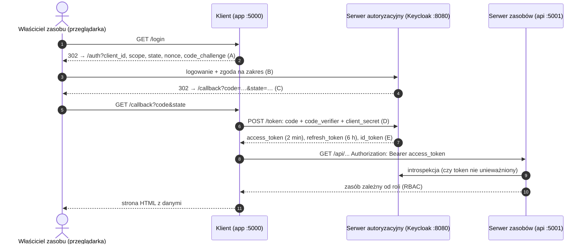

Uruchomienie:

```bash
pip install requests pyjwt cryptography playwright && python3 -m playwright install chromium
./run.sh             # pełny przebieg, ok. 4 min (czeka, aż access token wygaśnie)
./run.sh --no-wait   # bez czekania na wygaśnięcie tokenu
```

## Zadanie 1. Rejestracja aplikacji webowej

Aplikację rejestruję jako klienta `pbksi-webapp` w realmie `pbksi`. Najważniejsze pola definicji klienta ([realm-pbksi.json](keycloak/realm-pbksi.json)):

```json
{
  "clientId": "pbksi-webapp",
  "name": "PBKSI WebApp (lab 3)",
  "publicClient": false,
  "clientAuthenticatorType": "client-secret",
  "secret": "lab3-client-secret-zmien-mnie",
  "standardFlowEnabled": true,
  "implicitFlowEnabled": false,
  "directAccessGrantsEnabled": false,
  "consentRequired": true,
  "fullScopeAllowed": true,
  "rootUrl": "http://localhost:5000",
  "redirectUris": ["http://localhost:5000/callback"],
  "attributes": { "pkce.code.challenge.method": "S256" },
  "protocolMappers": [{ "name": "audience pbksi-api", "protocolMapper": "oidc-audience-mapper", ... }]
}
```

Co z tego wynika:

- `publicClient: false` — klient jest poufny. Aplikacja działa na serwerze, więc może przechować sekret, i przy wymianie kodu na token uwierzytelnia się parą `client_id` + `client_secret`.
- `redirectUris` — dokładny adres powrotu, bez symboli wieloznacznych. Kod autoryzacyjny trafi tylko pod ten adres.
- `standardFlowEnabled: true` — dozwolony jest tylko Authorization Code Flow. Wyłączyłem Implicit Grant (token w fragmencie URI, przestarzały według OAuth 2.0 Security BCP) i Direct Access Grants (hasło użytkownika podawane aplikacji, czyli dokładnie to, przed czym OAuth ma chronić).
- `pkce.code.challenge.method: S256` — Keycloak odrzuca żądanie autoryzacyjne bez PKCE.
- `consentRequired: true` — użytkownik wprost zgadza się na zakres, o który prosi aplikacja (krok B).
- Mapper `audience` dopisuje `pbksi-api` do pola `aud` access tokenu. Serwer zasobów przyjmuje tylko tokeny wystawione dla niego.
- `fullScopeAllowed: true` — bez tego role nie trafiały do tokenu. Keycloak przy imporcie klienta z `consentRequired: true` domyślnie ustawia `fullScopeAllowed` na `false`, a wtedy pole `realm_access.roles` jest puste. Wyszło to dopiero w teście.

Drugi klient, `pbksi-api`, służy serwerowi zasobów tylko do introspekcji tokenów (RFC 7662). Nie obsługuje żadnego przepływu logowania.

Klient w konsoli administracyjnej Keycloaka:

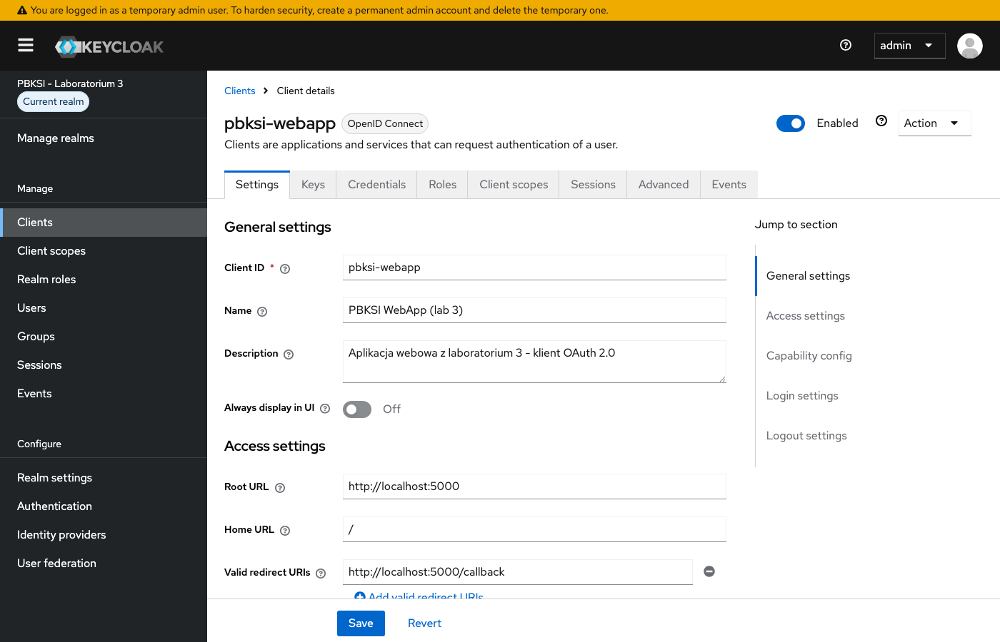

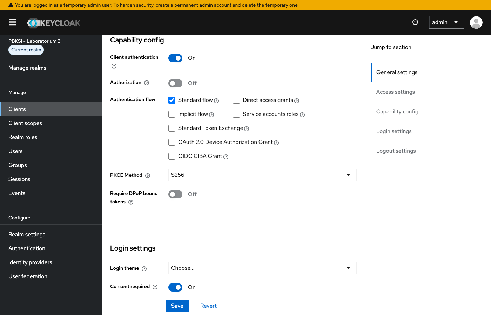

Dane uwierzytelniające klienta (`client_secret`), które aplikacja dostaje przy rejestracji:

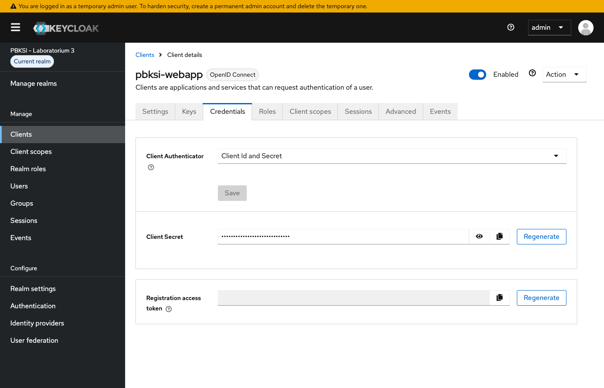

Role realmu (`admin`, `user`) i użytkownicy, z których korzysta model RBAC z zadania 5:

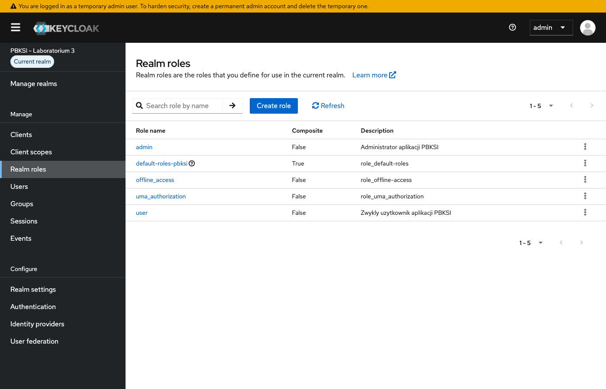

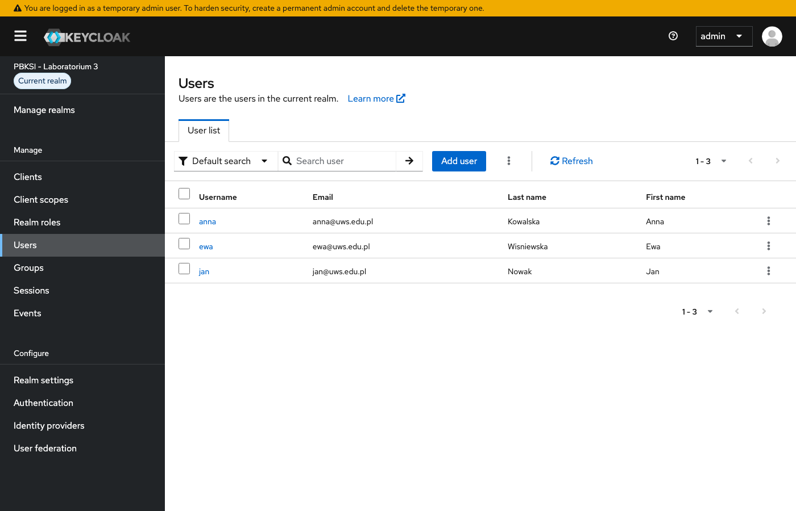

## Zadanie 2. Utworzenie aplikacji webowej

Aplikacja jest napisana we Flasku ([app/app.py](app/app.py)) i działa pod serwerem gunicorn. Kontroler wysyła żądania HTTP biblioteką `requests` i obsługuje te ścieżki:

| Metoda i ścieżka | Co robi |
|---|---|
| `GET /` | strona startowa, a po zalogowaniu dane użytkownika, role i lista zasobów |
| `GET /login` | krok A: generuje `state`, `nonce` i PKCE, przekierowuje do Keycloaka |
| `GET /callback` | kroki C–E: sprawdza `state`, wymienia kod na tokeny, weryfikuje ID token |
| `GET /zasob/<nazwa>` | pobiera zasób z API z tokenem Bearer (zadanie 5) |
| `GET /tokeny` | podgląd tokenów w sesji: czas wydania, wygaśnięcia, zawartość |
| `POST /odswiez` | ręczne odświeżenie access tokenu (chronione tokenem CSRF) |
| `GET /audyt` | dziennik audytu, tylko dla roli `admin` |
| `POST /wyloguj` | unieważnienie tokenów, zakończenie sesji, usunięcie danych (chronione tokenem CSRF) |

Serwer zasobów ([api/api.py](api/api.py)) to osobna mała aplikacja Flask, która przyjmuje wyłącznie żądania z tokenem Bearer.

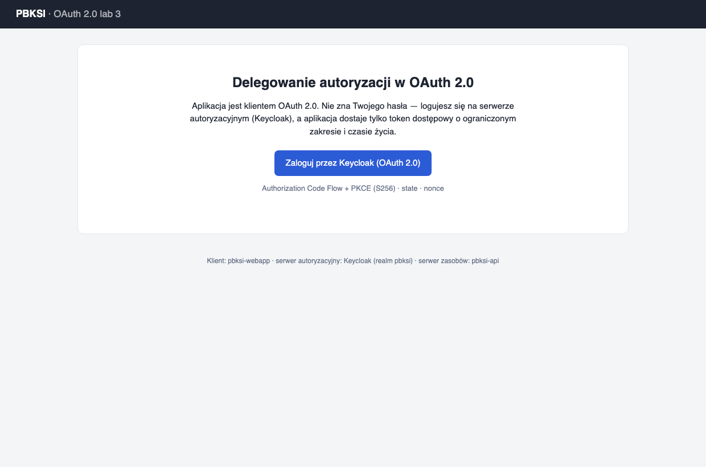

## Zadanie 3. Pobranie tokena

### W aplikacji

Po kliknięciu „Zaloguj przez Keycloak” aplikacja buduje żądanie autoryzacyjne (krok A). Zapis z [oauth_trace.log](logs/oauth_trace.log):

```http
HTTP 302 Location: http://localhost:8080/realms/pbksi/protocol/openid-connect/auth
    ?response_type=code
    &client_id=pbksi-webapp
    &redirect_uri=http%3A%2F%2Flocalhost%3A5000%2Fcallback
    &scope=openid+profile+email+roles
    &state=-NUGDrQJecw8XSO-4p9NDqMjqeZ1wY4B
    &nonce=ayYpimFQ5uLngl4DG6OIC-BqQbgYUX8P
    &code_challenge=UtUqaoUXmQGzn_rYJXVHGZC7wpCwchmqKVKhLJLNkmw
    &code_challenge_method=S256
```

- `state` to losowa wartość zapamiętana w sesji. Po powrocie z Keycloaka musi się zgadzać, co chroni `/callback` przed atakiem CSRF (zadanie 6).
- `nonce` trafia do ID tokenu i wiąże go z tym konkretnym żądaniem (ochrona przed powtórzeniem).
- `code_challenge = BASE64URL(SHA256(code_verifier))` to PKCE. Sam `code_verifier` zostaje w sesji aplikacji i jest wysyłany dopiero w kroku D.

Krok B: użytkownik loguje się na stronie Keycloaka, a nie aplikacji. Aplikacja nigdy nie widzi jego hasła:

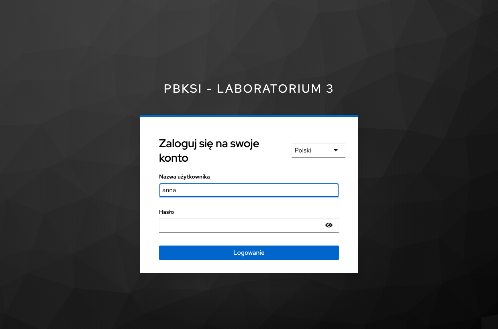

Następnie Keycloak pyta, czy użytkownik zgadza się udostępnić aplikacji wskazane zakresy. To jest właśnie delegowanie autoryzacji:

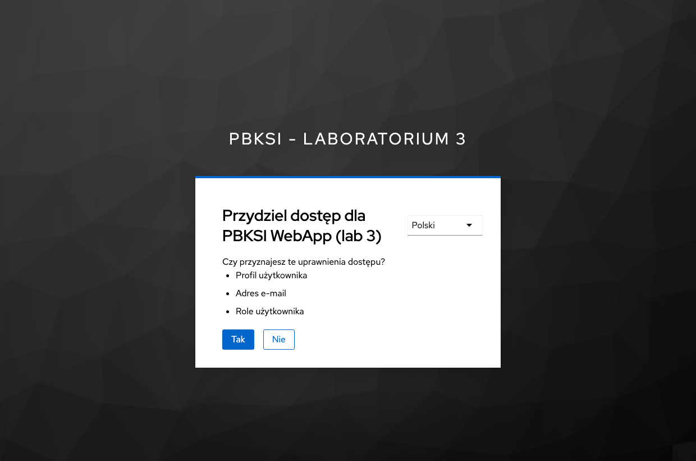

Krok C: Keycloak przekierowuje przeglądarkę na `http://localhost:5000/callback?state=…&code=…`. Aplikacja sprawdza `state`, a w krokach D i E wymienia kod na tokeny w kanale zwrotnym, bezpośrednio między kontenerami, z pominięciem przeglądarki:

```http
POST /realms/pbksi/protocol/openid-connect/token HTTP/1.1
Authorization: Basic base64(pbksi-webapp:***)
Content-Type: application/x-www-form-urlencoded

grant_type=authorization_code&code=4d8e1d9f-1136-af...&redirect_uri=http%3A%2F%2Flocalhost%3A5000%2Fcallback&code_verifier=i7TXCyzGn4WiTIDd...

HTTP 200
{
  "access_token": "eyJhbGciOiJSUzI1...MNS-xA (1213 B)",
  "expires_in": 120,
  "refresh_expires_in": 21600,
  "refresh_token": "eyJhbGciOiJIUzUx...9vpoJg (726 B)",
  "token_type": "Bearer",
  "id_token": "eyJhbGciOiJSUzI1...JCx4-Q (1150 B)",
  "scope": "openid profile email"
}
```

Odpowiedź ma postać jak w instrukcji: `access_token`, `token_type: Bearer`, `expires_in` i `refresh_token`. Dodatkowo jest `id_token`, bo korzystam z OpenID Connect, żeby znać tożsamość zalogowanego użytkownika. Przed zapisaniem tokenów aplikacja weryfikuje ID token ([app.py](app/app.py), funkcja `callback`): podpis RS256 kluczem z JWKS Keycloaka, `iss`, `aud == pbksi-webapp`, `exp` oraz zgodność `nonce`. Potem tworzy nową sesję z nowym identyfikatorem (ochrona przed session fixation) i zapisuje zdarzenie `Login Success`.

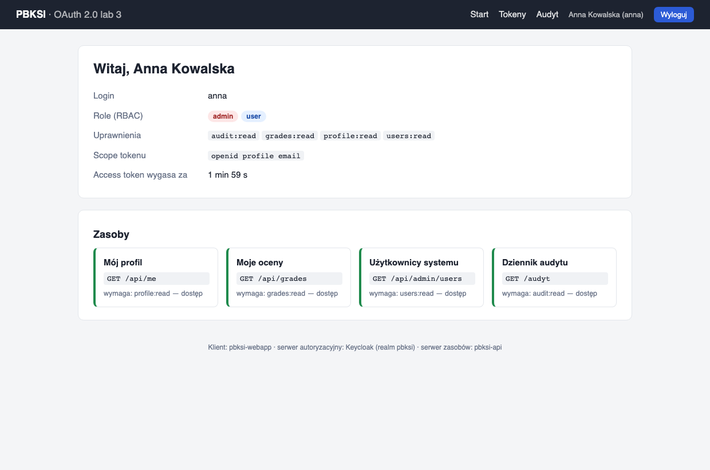

### Krok po kroku z wiersza poleceń

Żeby pokazać surowe żądania także od strony przeglądarki, [demo/oauth_cli_demo.py](demo/oauth_cli_demo.py) przechodzi kroki A–E bez przeglądarki. Pełny wynik jest w [logs/cli_demo.log](logs/cli_demo.log), poniżej skrót:

```text
A. GET http://localhost:8080/realms/pbksi/protocol/openid-connect/auth?response_type=code&client_id=pbksi-webapp
       &redirect_uri=http%3A%2F%2Flocalhost%3A5000%2Fcallback&scope=openid+profile+email+roles
       &state=6cJQ_dqXwzlNXzzkcNTcZA&code_challenge=WpReQ9XjDU_xT9y...&code_challenge_method=S256
   HTTP 200 -> strona logowania Keycloaka (8745 B HTML)
B. POST .../login-actions/authenticate?...  username=jan&password=***
   HTTP 302 -> .../login-actions/required-action (wymagana akcja OAUTH_GRANT = zgoda)
   HTTP 200 -> ekran zgody, aplikacja prosi o: Profil użytkownika, Adres e-mail, Role użytkownika
   POST .../login-actions/consent?...  accept=Yes
C. HTTP 302 Found
   Location: http://localhost:5000/callback?state=6cJQ_dqXwzlNXzzkcNTcZA&session_state=3b2eab3e-...&iss=...&code=fea8d270-...
   state zgodny z wysłanym: True
D. POST http://localhost:8080/realms/pbksi/protocol/openid-connect/token
   Authorization: Basic base64(pbksi-webapp:***)
   grant_type=authorization_code&code=fea8d270-...&redirect_uri=http://localhost:5000/callback&code_verifier=czkO_JMTjlnx...
E. HTTP 200 OK
   Cache-Control: no-store
   Pragma: no-cache
   { "access_token": "eyJhbGciOiJSUzI1NiIs...glHJU8dA", "expires_in": 120, "refresh_expires_in": 21600,
     "refresh_token": "eyJhbGciOiJIUzUxMiIs...85uOWJHQ", "token_type": "Bearer", ... }

access_token : iat=10:21:10 exp=10:23:10 -> czas życia 120 s
refresh_token: iat=10:21:10 exp=16:21:10 -> czas życia 21600 s  (= 6 h)
access_token: realm_access.roles = ['user'], aud = pbksi-api
```

Ten sam skrypt sprawdza, czy serwer autoryzacyjny odrzuca nadużycia przy wymianie kodu:

```text
Ponowne użycie tego samego kodu autoryzacyjnego (kod jest jednorazowy)
HTTP 400  {"error": "invalid_grant", "error_description": "Code not valid"}

PKCE: przechwycony kod bez właściwego code_verifier jest bezużyteczny
POST /token ... code=<nowy kod>&code_verifier=<inny, losowy>
HTTP 400  {"error": "invalid_grant", "error_description": "PKCE verification failed: Code mismatch"}

POST /token ... poprawny code i code_verifier, ale zły client_secret
HTTP 401  {"error": "unauthorized_client", "error_description": "Invalid client or Invalid client credentials"}
```

Kod autoryzacyjny jest więc jednorazowy, a sam w sobie nic nie daje: do wymiany potrzebny jest jeszcze `code_verifier` (znany tylko instancji klienta, która zaczęła logowanie) i sekret klienta.

## Zadanie 4. Implementacja tokena odświeżającego

**Konfiguracja czasów życia** (realm `pbksi`):

```json
"accessTokenLifespan": 120,
"ssoSessionIdleTimeout": 21600,
"ssoSessionMaxLifespan": 21600,
"clientSessionIdleTimeout": 21600,
"clientSessionMaxLifespan": 21600,
"revokeRefreshToken": true,
"refreshTokenMaxReuse": 0
```

- Access token żyje 2 minuty. Tak krótko, żeby w trakcie ćwiczenia dało się zobaczyć jego wygaśnięcie i odświeżenie.
- Refresh token żyje 6 godzin. W Keycloaku jego ważność wynika z czasu życia sesji, więc ustawiam maksymalny czas sesji i czas bezczynności na 6 h. Po 6 godzinach od zalogowania refresh token przestaje działać niezależnie od tego, ile razy był używany, i trzeba zalogować się ponownie.
- `revokeRefreshToken: true` i `refreshTokenMaxReuse: 0` włączają rotację: każde odświeżenie wydaje nowy refresh token, a poprzedni jest od razu nieważny.

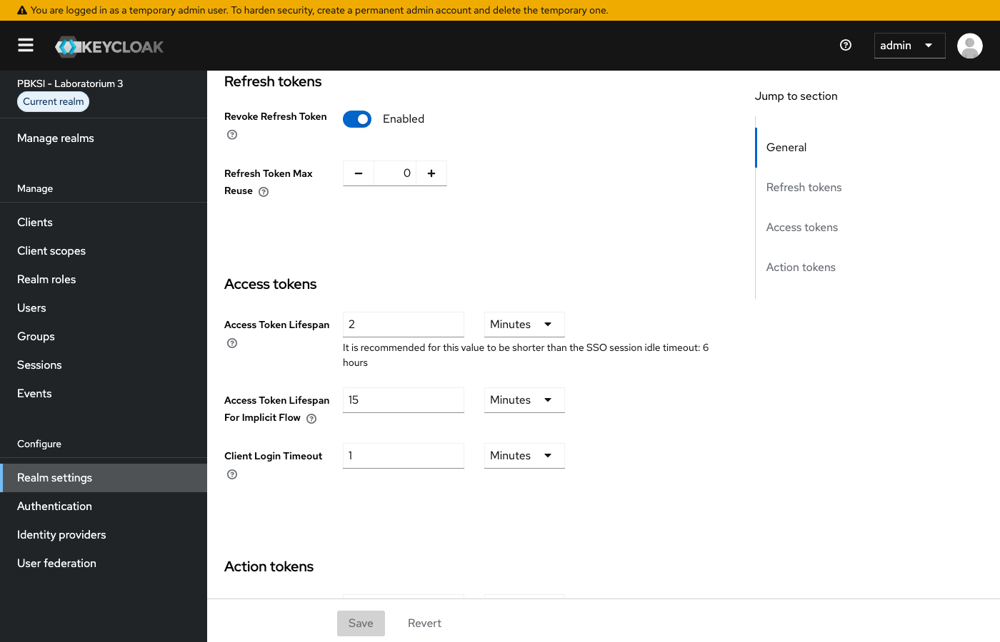

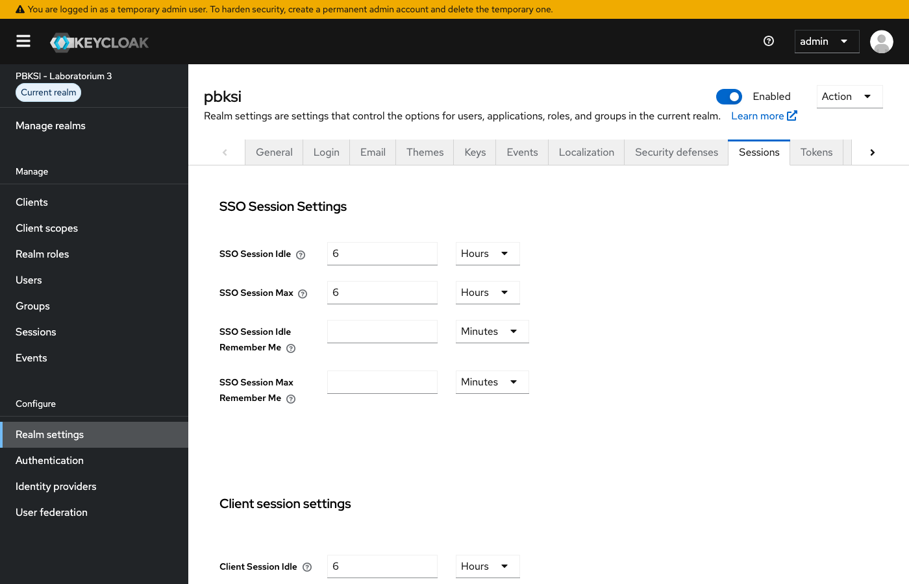

W aplikacji widać, że tokeny dostały takie czasy życia (`exp - iat`: 120 s i 21600 s = 6 h):


**Odświeżanie w aplikacji.** Przed każdym żądaniem do API aplikacja sprawdza, czy access token wygasł albo wygaśnie w ciągu 10 sekund. Jeśli tak, wymienia refresh token na nowy komplet tokenów ([app.py](app/app.py), funkcje `access_token` i `refresh_tokens`):

```python
def access_token():
    t = g.sess["tokens"]
    now = time.time()
    if t["expires_at"] - REFRESH_MARGIN <= now:
        audit("Access Token Expired" if t["expires_at"] <= now else "Access Token Expiring", ...)
        if not refresh_tokens("access token expired"):
            return None                       # refresh token nieważny -> trzeba się zalogować
    return g.sess["tokens"]["access_token"]

def refresh_tokens(reason="auto"):
    if t["refresh_expires_at"] <= time.time():
        audit("Token Expired", user=user, token="refresh_token", detail="re-login required")
        ...
    r = token_request(..., {"grant_type": "refresh_token", "refresh_token": t["refresh_token"]})
    if r.status_code != 200:
        audit("Token Expired", user=user, token="refresh_token", detail=f"refresh failed: {err}")
        destroy_session(g.sid)
        return False
    store_tokens(sess, r.json())              # zapisuje NOWY access token i NOWY refresh token
    audit("Access Token Refreshed", ...)
```

Skrypt zrzutów odczekał 125 s, aż access token anny wygaśnie, i otworzył zasób. Aplikacja sama odświeżyła token:

```text
2026-11-08 10:23:57 Access Token Expired [user=anna exp=10:23:46]
2026-11-08 10:23:57 Access Token Refreshed [user=anna reason=access token expired access_valid_s=120]
2026-11-08 10:23:57 Resource Access [user=anna resource=/api/grades]
```

Po odświeżeniu oba tokeny mają nowe `iat`. Access token znowu ma 2 minuty, a `exp` refresh tokenu się nie przesunął: nadal jest to 6 godzin od zalogowania.

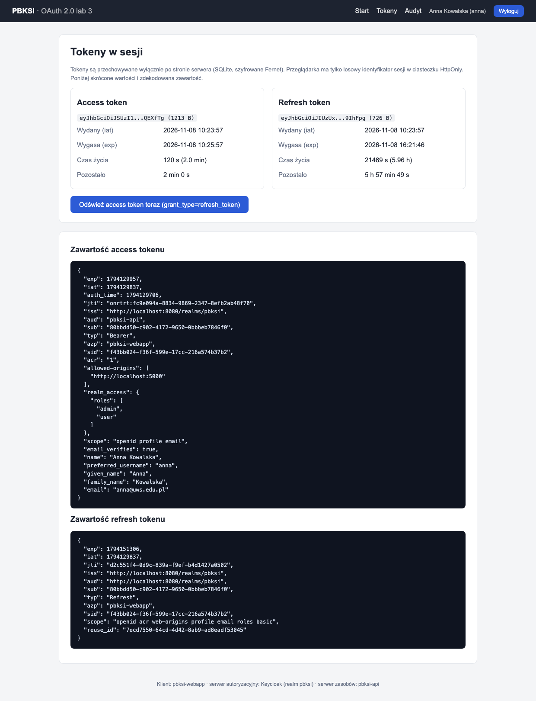

To samo w kanale zwrotnym ([oauth_trace.log](logs/oauth_trace.log)). `refresh_expires_in` maleje, bo liczy się od początku sesji:

```http
POST /realms/pbksi/protocol/openid-connect/token HTTP/1.1
Authorization: Basic base64(pbksi-webapp:***)

grant_type=refresh_token&refresh_token=eyJhbGciOiJIUzUx...9vpoJg

HTTP 200
{ "access_token": "eyJhbGciOiJSUzI1...QEXfTg (1213 B)", "expires_in": 120,
  "refresh_expires_in": 21469, "refresh_token": "eyJhbGciOiJIUzUx...9IhFpg (726 B)", ... }
```

**Rotacja i wykrycie ponownego użycia** ([cli_demo.log](logs/cli_demo.log)):

```text
nowy refresh_token różny od starego: True
nowy refresh_token: iat=10:21:12 exp=16:21:10 -> czas życia 21598 s
introspekcja nowego access tokenu: active = True

Ponowne użycie STAREGO refresh tokenu (rotacja: revokeRefreshToken=true, refreshTokenMaxReuse=0)
HTTP 400  {"error": "invalid_grant", "error_description": "Maximum allowed refresh token reuse exceeded"}

introspekcja NOWEGO access tokenu po tej próbie: active = False
GET http://localhost:5001/api/me   (nowy access token po wykryciu ponownego użycia)
HTTP 401  WWW-Authenticate: Bearer realm="pbksi-api", error="invalid_token", error_description="The access token has been revoked"
```

Wynik tego testu mnie zaskoczył. Stary refresh token jest odrzucany, to było oczekiwane. Ale Keycloak traktuje próbę jego użycia jako sygnał kradzieży i unieważnia całą sesję, łącznie z nowym, prawidłowym access tokenem. Jeśli ktoś ukradł refresh token, to zarówno on, jak i prawowity klient tracą dostęp, a użytkownik musi zalogować się ponownie.

**Wygaśnięcie refresh tokenu.** Nie czekałem 6 godzin. Zamiast tego skrypt jako administrator zakończył w Keycloaku sesję użytkowniczki `ewa` (`POST /admin/realms/pbksi/users/{id}/logout`). Dla aplikacji wygląda to tak samo jak wygaśnięcie refresh tokenu. Gdy access token ewy wygasł, aplikacja spróbowała go odświeżyć, dostała odmowę, usunęła sesję i odesłała użytkowniczkę do logowania:

```text
2026-11-08 10:23:58 Access Token Expired [user=ewa exp=10:23:51]
2026-11-08 10:23:58 Token Expired [user=ewa token=refresh_token detail=refresh failed: Session not active]
```

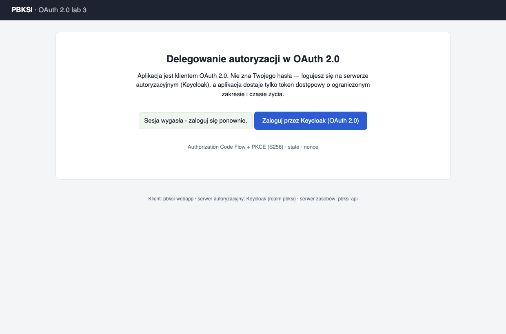

Na stronie „Tokeny” jest też przycisk do ręcznego odświeżenia (`POST /odswiez` z tokenem CSRF):

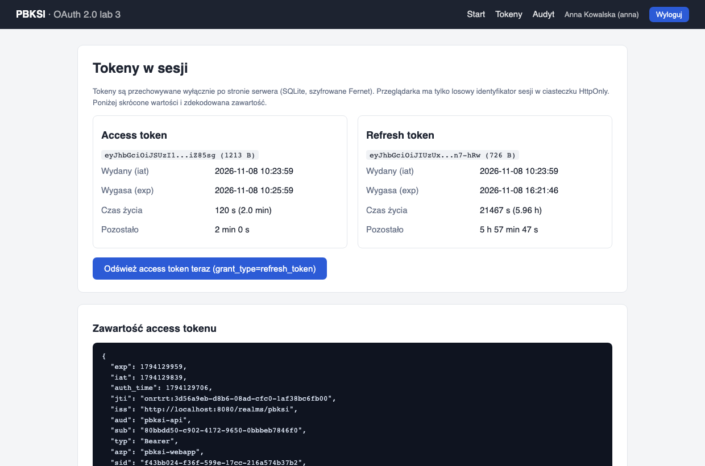

## Zadanie 5. Wyświetlenie zasobów

**Model RBAC.** Role nadaje Keycloak i trafiają do access tokenu (`realm_access.roles`). Serwer zasobów zamienia role na uprawnienia, a uprawnienia decydują o dostępie do zasobów. Użytkownik bez żadnej roli aplikacyjnej dostaje rolę `guest`.

```python
ROLE_PERMISSIONS = {
    "admin": {"profile:read", "grades:read", "users:read", "audit:read"},
    "user":  {"profile:read", "grades:read"},
    "guest": {"profile:read"},  # zalogowany, ale bez żadnej roli aplikacyjnej
}
```

| Zasób | Endpoint | Uprawnienie | admin (anna) | user (jan) | guest (ewa) |
|---|---|---|:-:|:-:|:-:|
| Mój profil | `GET /api/me` | `profile:read` | ✔ | ✔ | ✔ |
| Moje oceny | `GET /api/grades` | `grades:read` | ✔ | ✔ | ✘ |
| Użytkownicy systemu | `GET /api/admin/users` | `users:read` | ✔ | ✘ | ✘ |
| Dziennik audytu | `GET /audyt` (w aplikacji) | `audit:read` | ✔ | ✘ | ✘ |

Decyzję podejmuje serwer zasobów, a nie interfejs aplikacji. Aplikacja wyszarza niedostępne kafelki, ale bezpośrednie żądanie i tak dostanie 403. Uprawnienia, którymi aplikacja steruje wyglądem strony, pochodzą z `GET /api/me`, więc model jest zdefiniowany w jednym miejscu.

**Weryfikacja tokenu w API** ([api.py](api/api.py), funkcja `authenticate`):

1. nagłówek `Authorization: Bearer …` (RFC 6750, rozdz. 2.1); token w parametrze URI, jak w drugim przykładzie z instrukcji, nie jest przyjmowany, bo trafiałby do logów i historii przeglądarki,
2. podpis RS256 kluczem z JWKS Keycloaka oraz `iss`, `aud == pbksi-api` i `exp`,
3. introspekcja w Keycloaku (RFC 7662), czyli sprawdzenie, czy token nie został unieważniony przed upływem `exp`,
4. sprawdzenie uprawnienia wymaganego przez endpoint.

Błędy są zwracane w formacie z RFC 6750, tym samym co w instrukcji:

```text
GET /api/me   (bez nagłówka Authorization)
HTTP 401  WWW-Authenticate: Bearer realm="pbksi-api"

GET /api/me   (token ze zmienionym podpisem)
HTTP 401  WWW-Authenticate: Bearer realm="pbksi-api", error="invalid_token", error_description="The access token is invalid"

GET /api/grades   (jan ma rolę user - dostęp)
HTTP 200  {"login": "jan", "oceny": [{"ocena": 4.0, "przedmiot": "Problemy bezpieczeństwa komputerowego w SI"}, ...]}

GET /api/admin/users   (jan nie ma roli admin)
HTTP 403  WWW-Authenticate: Bearer realm="pbksi-api", error="insufficient_scope",
          error_description="Permission users:read required", scope="users:read"
```

**Administrator (anna)** ma dostęp do wszystkiego:

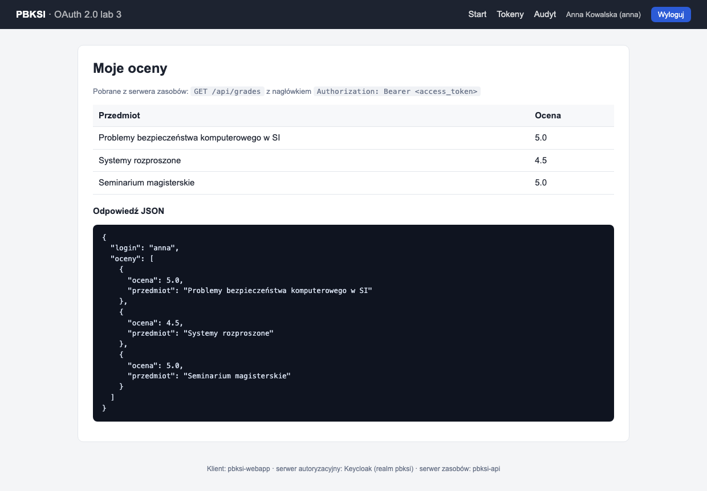

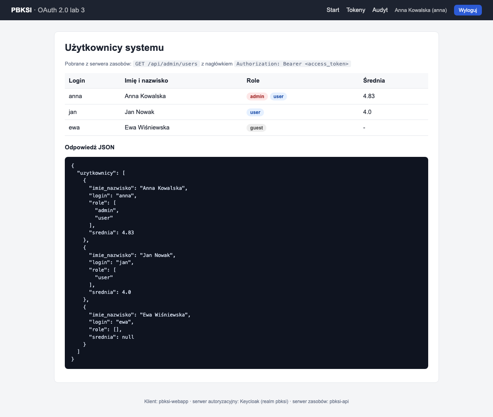

**Zwykły użytkownik (jan)** widzi swoje oceny, ale nie listę użytkowników ani audytu:

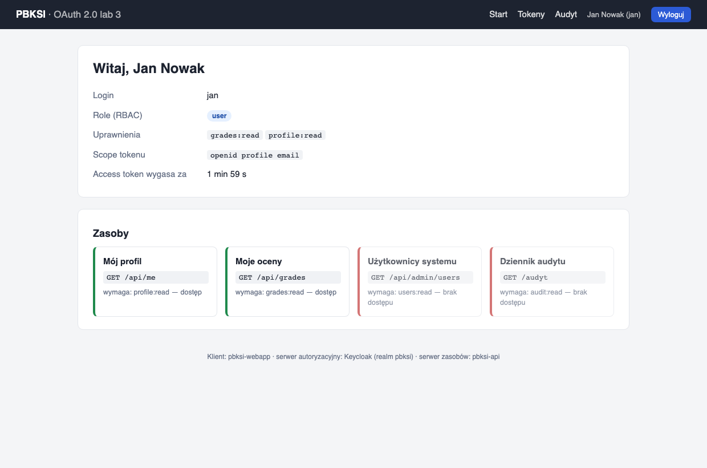

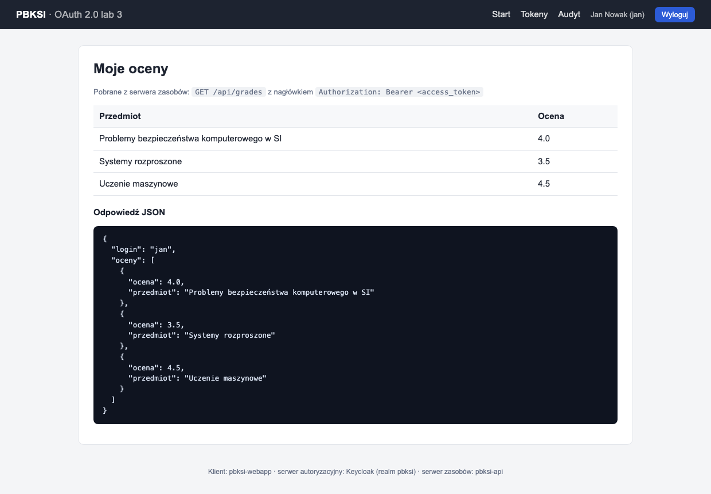

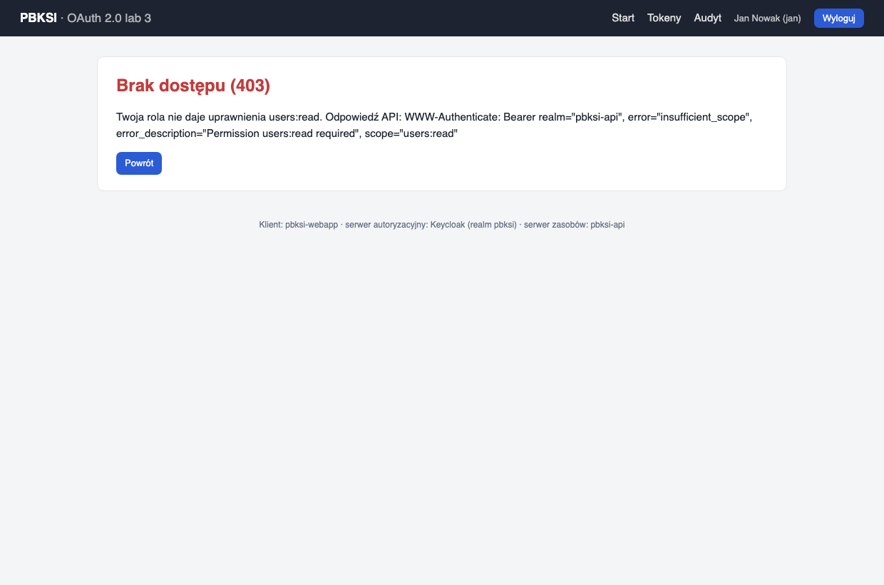

**Użytkowniczka bez roli (ewa)** widzi tylko swój profil:

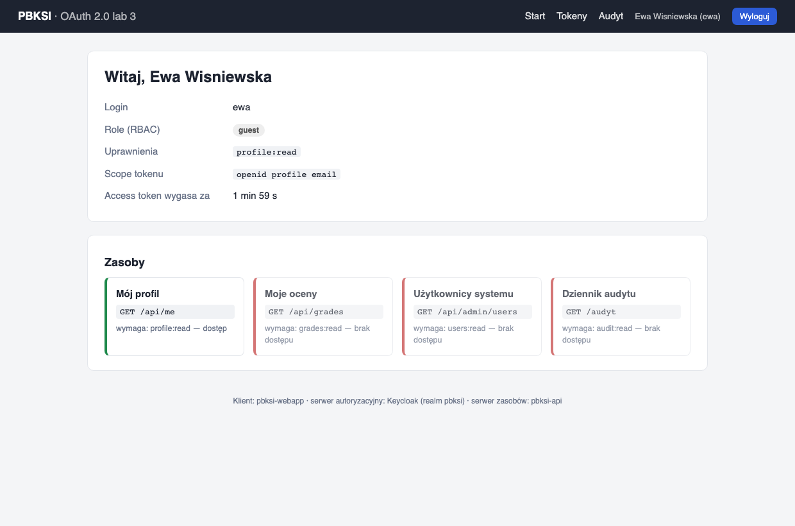

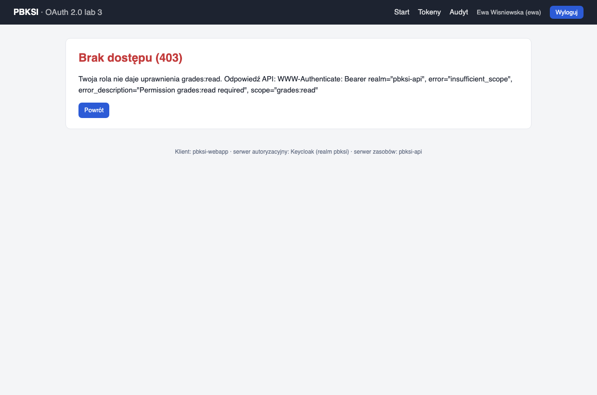

## Zadanie 6. Zabezpieczenie tokena

### Przechowywanie tokenów

- Tokeny nigdy nie trafiają do przeglądarki: nie ma ich ani w `localStorage`, ani w ciasteczkach, ani w JavaScripcie. Przeglądarka ma tylko losowy identyfikator sesji (`secrets.token_urlsafe(32)`) w ciasteczku `pbksi_sid` z flagami `HttpOnly` i `SameSite=Lax`:

  ```text
  ciasteczka aplikacji: [..., ('pbksi_sid', True, 'Lax')]      # (nazwa, HttpOnly, SameSite)
  ```

- Sesje leżą po stronie serwera w SQLite ([app/store.py](app/store.py)). Cała zawartość sesji (access, refresh i ID token, `state`, `code_verifier`, token CSRF) jest szyfrowana algorytmem **Fernet** (AES-128-CBC + HMAC-SHA256) kluczem `TOKEN_ENC_KEY`. Klucz jest generowany przez `run.sh` do pliku `.env`, który nie trafia do repozytorium.
- W bazie zamiast identyfikatora sesji jest zapisany tylko jego skrót SHA-256. Wyciek bazy nie pozwala więc ani odczytać tokenów, ani podszyć się pod sesję przez podstawienie ciasteczka.

Zawartość bazy w chwili, gdy anna jest zalogowana ([sessions_db.log](logs/sessions_db.log)):

```text
sid_hash = f3ed3f58184c228afc632c090eb8e500c67694fd171c00451e1f65d919f15947
created  = 1794129706   expires = 1794151306
data     = gAAAAABq8D8qGuEwpxvW-j5wI5p_TNhTm5knW1utnFhYPWr_BTt5iqx6aRPaRLgROv33fBaqXM8rY7psydZxzE01u8k0RDvNi-7B... (4644 B)
```

- Odpowiedzi aplikacji mają nagłówki bezpieczeństwa:

  ```text
  Content-Security-Policy: default-src 'self'; script-src 'self'; style-src 'self'; img-src 'self' data:; frame-ancestors 'none'; form-action 'self'
  X-Frame-Options: DENY
  Referrer-Policy: same-origin
  Cache-Control: no-store
  ```

  CSP utrudnia XSS, `frame-ancestors`/`X-Frame-Options` blokuje clickjacking, a `Cache-Control: no-store` nie pozwala zapisać stron z danymi w pamięci podręcznej. `Referrer-Policy: same-origin` sprawia, że adres `/callback?code=…` nie wycieka w nagłówku `Referer` do innych serwisów. Na początku ustawiłem tu `no-referrer`, ale wtedy Chromium wysyła w formularzach `Origin: null` i moja ochrona CSRF blokowała prawidłowe wylogowanie.

### Ochrona przed CSRF

Wdrożyłem trzy warstwy:

1. **`state` w OAuth** chroni `/callback` przed „login CSRF”, czyli podrzuceniem ofierze kodu autoryzacyjnego atakującego. Bez tego ofiara byłaby zalogowana na konto atakującego. Test: przekierowanie na `/callback?code=kod-atakujacego&state=spreparowany` w sesji, która czeka na inny `state`:

   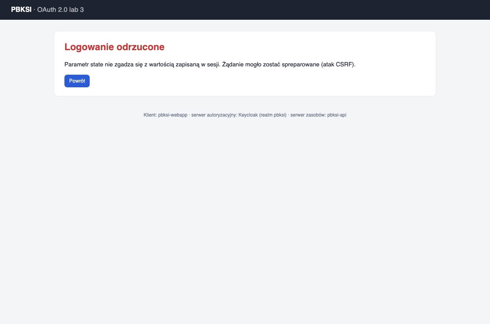

   ```text
   2026-11-08 10:24:02 Login Failed [reason=state mismatch (possible CSRF) ip=172.18.0.1]
   ```

2. **Token synchronizujący** chroni wszystkie formularze zmieniające stan (`POST /wyloguj`, `POST /odswiez`). Każda sesja ma losowy token CSRF, osadzony w ukrytym polu formularza. Żądanie bez niego albo z innym tokenem dostaje 403. Dodatkowo, jeśli przeglądarka wysłała nagłówek `Origin`, musi on być równy `http://localhost:5000`.
3. **`SameSite=Lax`** sprawia, że przeglądarka nie dołącza ciasteczka sesji do żądań POST wysyłanych z innych stron.

Test: obca strona („Wygrałeś nagrodę!”) automatycznie wysyła formularz `POST http://localhost:5000/wyloguj` w przeglądarce, w której anna jest zalogowana. Drugi test to żądanie z ciasteczkiem sesji anny, ale ze zgadywanym tokenem CSRF:

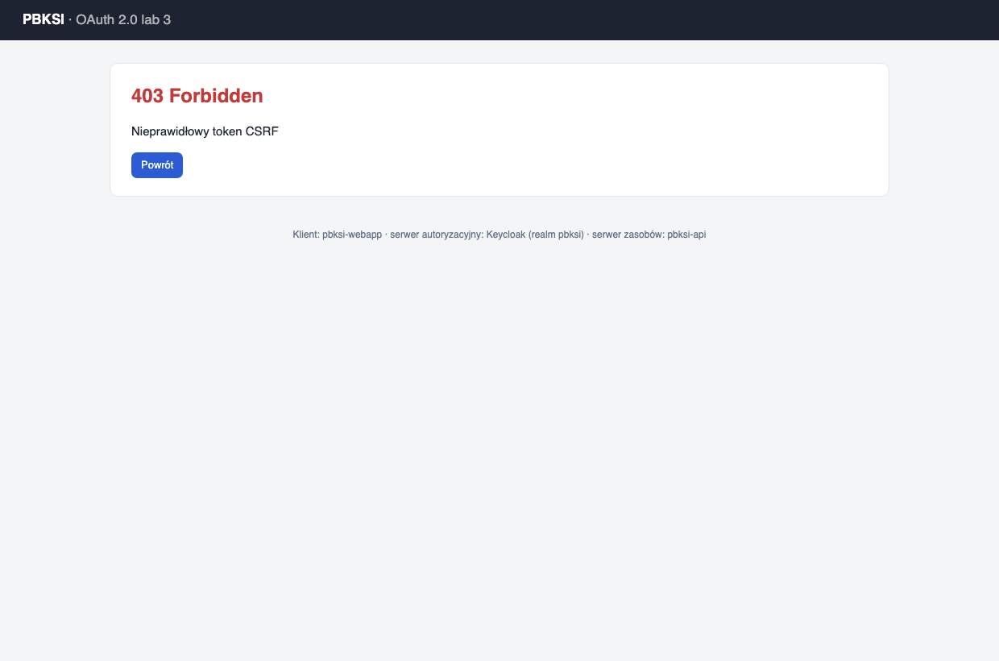

```text
2026-11-08 10:21:49 CSRF Attempt Blocked [path=/wyloguj origin=null ip=172.18.0.1]
2026-11-08 10:21:49 CSRF Attempt Blocked [path=/odswiez ip=172.18.0.1 user=anna]
```

Do tego samego przepływu należą zabezpieczenia z zadania 3: **PKCE** (przechwycony kod jest bezużyteczny), **nonce** w ID tokenie, **nowy identyfikator sesji** po zalogowaniu, dokładny `redirect_uri`, krótki czas życia access tokenu i **rotacja refresh tokenów** z wykrywaniem ponownego użycia.

### Usuwanie tokenów po wylogowaniu

`POST /wyloguj` (z tokenem CSRF) wykonuje trzy kroki ([app.py](app/app.py), funkcja `logout`):

1. unieważnia access token w Keycloaku (`POST /revoke`, RFC 7009), więc od tej chwili introspekcja zwraca `active: false` i API odrzuca token, choć jego `exp` jeszcze nie minął,
2. kończy sesję na serwerze autoryzacyjnym (`POST /logout` z refresh tokenem), co unieważnia refresh token i sesję SSO; następne logowanie znowu wymaga hasła,
3. usuwa wiersz sesji z bazy aplikacji i kasuje ciasteczko w przeglądarce.

```text
2026-11-08 10:24:02 Logout [user=jan revoke_access_token=200 idp_session_logout=204 local_tokens=deleted]
```

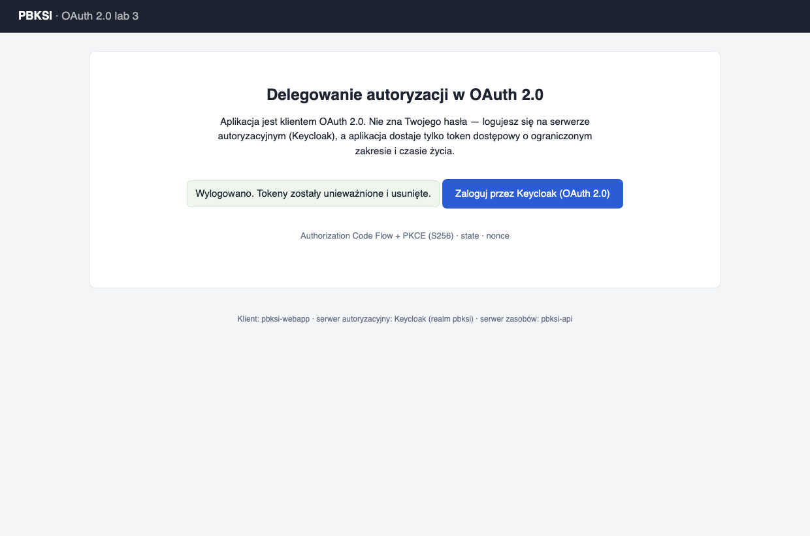

Że tokeny po unieważnieniu naprawdę nie działają, pokazuje [cli_demo.log](logs/cli_demo.log):

```text
introspekcja access tokenu: active = True
POST http://localhost:8080/realms/pbksi/protocol/openid-connect/revoke  token_type_hint=refresh_token -> HTTP 200
POST http://localhost:8080/realms/pbksi/protocol/openid-connect/revoke  token_type_hint=access_token -> HTTP 200
introspekcja access tokenu po revoke: active = False

GET http://localhost:5001/api/me   (unieważniony access token)
HTTP 401  WWW-Authenticate: Bearer realm="pbksi-api", error="invalid_token", error_description="The access token has been revoked"

POST /token grant_type=refresh_token (unieważniony refresh token)
HTTP 400  {"error": "invalid_grant", "error_description": "Session not active"}
```

Dlatego API, oprócz lokalnego sprawdzenia podpisu, pyta Keycloaka o stan tokenu (introspekcja). Sama weryfikacja JWT przepuszczałaby unieważniony token aż do upływu `exp`. Kosztem jest jedno dodatkowe żądanie na każde wywołanie API.

### Audyt bezpieczeństwa

Każde zdarzenie bezpieczeństwa aplikacja zapisuje jako jedną linię w [logs/audit.log](logs/audit.log), w formacie z instrukcji: data, czas, zdarzenie i szczegóły w nawiasie. Pełny dziennik z przebiegu `run.sh`:

```text
2026-11-08 10:21:45 Authorization Request [ip=172.18.0.1 scope=openid,profile,email,roles]
2026-11-08 10:21:46 Login Success [user=anna ip=172.18.0.1 access_valid_s=120 refresh_valid_s=21600]
2026-11-08 10:21:47 Resource Access [user=anna resource=/api/grades]
2026-11-08 10:21:47 Resource Access [user=anna resource=/api/admin/users]
2026-11-08 10:21:49 CSRF Attempt Blocked [path=/wyloguj origin=null ip=172.18.0.1]
2026-11-08 10:21:49 CSRF Attempt Blocked [path=/odswiez ip=172.18.0.1 user=anna]
2026-11-08 10:21:50 Authorization Request [ip=172.18.0.1 scope=openid,profile,email,roles]
2026-11-08 10:21:50 Login Failed [reason=access_denied ip=172.18.0.1]
2026-11-08 10:21:51 Authorization Request [ip=172.18.0.1 scope=openid,profile,email,roles]
2026-11-08 10:21:51 Login Success [user=ewa ip=172.18.0.1 access_valid_s=120 refresh_valid_s=21600]
2026-11-08 10:21:52 Access Denied [user=ewa resource=/api/grades need=grades:read]
2026-11-08 10:23:57 Access Token Expired [user=anna exp=10:23:46]
2026-11-08 10:23:57 Access Token Refreshed [user=anna reason=access token expired access_valid_s=120]
2026-11-08 10:23:57 Resource Access [user=anna resource=/api/grades]
2026-11-08 10:23:58 Access Token Expired [user=ewa exp=10:23:51]
2026-11-08 10:23:58 Token Expired [user=ewa token=refresh_token detail=refresh failed: Session not active]
2026-11-08 10:23:59 Access Token Refreshed [user=anna reason=manual access_valid_s=120]
2026-11-08 10:23:59 Authorization Request [ip=172.18.0.1 scope=openid,profile,email,roles]
2026-11-08 10:24:00 Login Success [user=jan ip=172.18.0.1 access_valid_s=120 refresh_valid_s=21600]
2026-11-08 10:24:00 Resource Access [user=jan resource=/api/grades]
2026-11-08 10:24:01 Access Denied [user=jan resource=/api/admin/users need=users:read]
2026-11-08 10:24:01 Access Denied [user=jan resource=/audyt need=audit:read]
2026-11-08 10:24:02 Logout [user=jan revoke_access_token=200 idp_session_logout=204 local_tokens=deleted]
2026-11-08 10:24:02 Authorization Request [ip=172.18.0.1 scope=openid,profile,email,roles]
2026-11-08 10:24:02 Login Failed [reason=state mismatch (possible CSRF) ip=172.18.0.1]
2026-11-08 10:24:04 Logout [user=anna revoke_access_token=200 idp_session_logout=204 local_tokens=deleted]
```

`Login Failed [reason=access_denied]` to odmowa zgody na ekranie Keycloaka (przycisk „Nie”). Keycloak odsyła wtedy na `/callback?error=access_denied`:

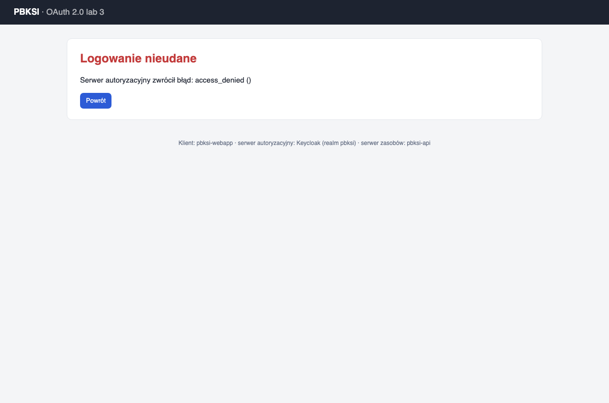

Dziennik jest też dostępny w aplikacji, ale tylko dla roli `admin` (uprawnienie `audit:read`):

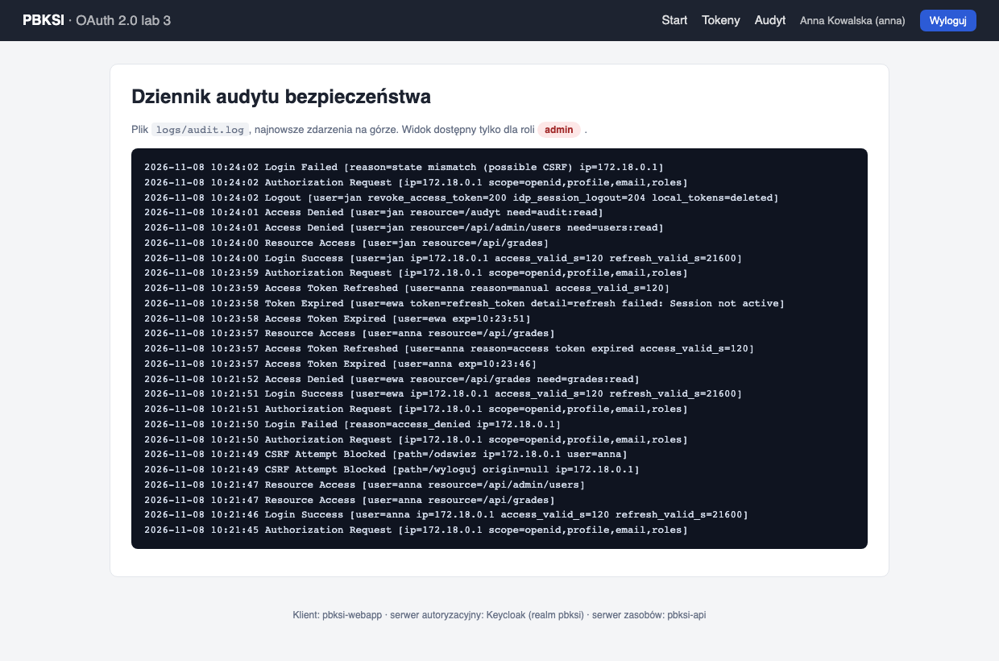

Po stronie serwera autoryzacyjnego te same zdarzenia rejestruje Keycloak ([keycloak_events.log](logs/keycloak_events.log), skrót). Widać tam także to, czego aplikacja nie zobaczy, np. powód odrzucenia kodu:

```text
10:21:10 type="CODE_TO_TOKEN_ERROR" clientId="pbksi-webapp" error="invalid_code"
10:21:10 type="CODE_TO_TOKEN_ERROR" clientId="pbksi-webapp" error="pkce_verification_failed"
10:21:10 type="CODE_TO_TOKEN_ERROR" clientId="pbksi-webapp" error="invalid_client_credentials"
10:21:12 type="REFRESH_TOKEN_ERROR" clientId="pbksi-webapp" error="invalid_token" reason="Maximum allowed refresh token reuse exceeded"
10:21:50 type="LOGIN_ERROR"         clientId="pbksi-webapp" error="rejected_by_user"
10:23:57 type="REFRESH_TOKEN"       clientId="pbksi-webapp" userId="80bbdd50-..."
10:24:02 type="REVOKE_GRANT"        clientId="pbksi-webapp" token_id="onrtac:b0ea3cc9-..."
10:24:02 type="LOGOUT"              clientId="pbksi-webapp" userId="54b96f49-..."
```

## Podsumowanie

Zarejestrowałem aplikację `pbksi-webapp` jako poufnego klienta OAuth 2.0 w serwerze autoryzacyjnym Keycloak i napisałem do niej aplikację webową we Flasku. Aplikacja pobiera token przez Authorization Code Flow (kroki A–E z instrukcji) z PKCE i OpenID Connect. Access token żyje 2 minuty, a refresh token 6 godzin. Aplikacja odświeża access token sama, gdy ten wygasa, a refresh tokeny są rotowane, z wykrywaniem ponownego użycia. Osobny serwer zasobów przyjmuje tylko tokeny Bearer i według prostego modelu RBAC (`admin` / `user` / `guest`) zwraca różne dane. Tokeny są przechowywane wyłącznie po stronie serwera, zaszyfrowane. Formularze chroni token CSRF, a `/callback` parametr `state`. Wylogowanie unieważnia tokeny w Keycloaku i usuwa je z aplikacji. Zdarzenia bezpieczeństwa trafiają do dziennika audytu.

Odstępstwa i uproszczenia, w skrócie:

- serwer autoryzacyjny to Keycloak uruchomiony lokalnie, a nie GitHub, Facebook czy Google: tylko tak mogłem ustawić 6-godzinny refresh token i krótkie access tokeny z zadania 4,
- całość działa po `http://localhost`, a nie po HTTPS. W prawdziwym wdrożeniu konieczny byłby TLS (token Bearer w nagłówku jest równoważny hasłu), a ciasteczko sesji dostałoby flagę `Secure` (w kodzie jest przełącznik `COOKIE_SECURE=1`) i prefiks `__Host-`,
- Keycloak działa w trybie `start-dev` z wbudowaną bazą H2, więc po restarcie kontenera wszystkie sesje znikają,
- testowe hasła, sekrety klientów i hasło administratora Keycloaka są w repozytorium celowo, żeby ćwiczenie dało się odtworzyć poleceniem `./run.sh`.
